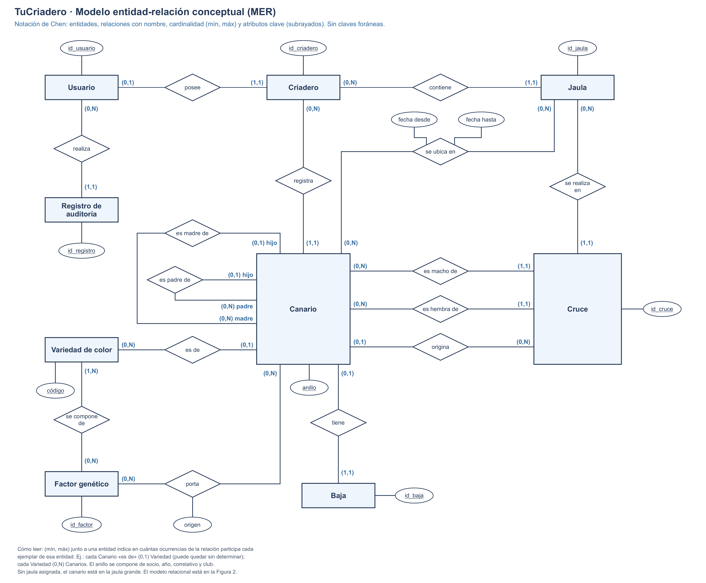
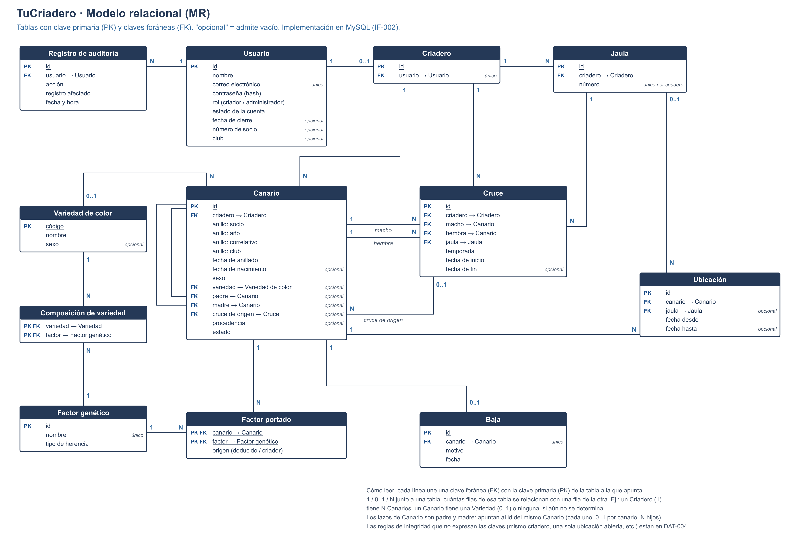

# Resumen para backend

Guía de trabajo para el equipo de backend del **Sistema de Gestión de Criadero de Canarios**. Resume lo que el SRS v1.1 (`docs/srs/`) exige a la lógica y a la base de datos. **Si este resumen y el SRS no coinciden, manda el SRS**, salvo los ajustes del cliente de [`ajustes-cliente.md`](ajustes-cliente.md), que lo amplían sin modificarlo. Cualquier otro cambio de requisitos se pide al PM.

El contrato con frontend (rutas, datos de cada vista y campos de los formularios) está en `docs/contrato-back-front.md`.

Todos los valores del SRS, incluidos los numéricos de los requisitos no funcionales, son requisitos: el cliente los valida con su firma (SRS §1.1, CR-014). Si el cliente pide cambiar alguno, el PM lo registra como CR y actualiza los issues afectados.

## 1. Stack

| Capa | Tecnología | Nota |
|---|---|---|
| Lenguaje | PHP | La versión la define el equipo; se recomienda PHP 8.2 o superior. |
| Interfaz | HTML embebido en PHP | Las páginas se generan en el servidor. No hay API para un frontend separado. |
| Base de datos | MySQL | Usar **MySQL 8.0.16 o superior** (recomendado 8.4 LTS): antes de esa versión MySQL ignora las restricciones `CHECK` que pide IF-002. Instalación, migraciones y qué se sube a GitHub: [`base-de-datos.md`](base-de-datos.md). |
| Despliegue | AWS | Entorno de pruebas (staging) y producción. |
| Pruebas | PHPUnit (código) y Apache JMeter (carga) | Sujetas a cambio, según el SRS. |
| PDF de la ficha | Dompdf (propuesta), instalado con Composer | AC-04. La librería y el uso de Composer los confirma la tarea de estructura base. |
| Repositorio | GitHub | Ver `CONTRIBUTING.md`. |

## 2. Arquitectura propuesta

```
backend/                → todo lo de esta guía
  Controllers/          → reciben la petición, validan permisos y llaman a los servicios
  Services/             → reglas de negocio; Services/Genetica para el cálculo de cruces
  Models/               → acceso a datos con PDO y consultas preparadas
  database/
    migrations/         → NNN_descripcion.sql: creación y cambios de tablas (ver base-de-datos.md)
    seeds/              → catálogo de variedades, factores y composición; datos de prueba inventados
    migrar.php          → aplica migraciones y seeds; crea la cuenta de administrador
  tests/                → PHPUnit
frontend/               → vistas y estilos (ver frontend.md)
public/index.php        → punto de entrada: solo carga el backend
```

**Regla de oro del aislamiento (RF003, SEG-001, SEG-005):** el `criadero_id` se toma **siempre de la sesión**, nunca de un parámetro del formulario o de la URL. Toda consulta a canarios, jaulas, cruces, ubicaciones, bajas y factores portados filtra por ese criadero. Pedir el ID de un registro de otro criadero debe responder como si no existiera.

## 3. Modelo de datos

Fuente: SRS §4.7, DAT-001 y DAT-004. El modelo se presenta en dos niveles:

- **Figura 1 — Modelo entidad-relación conceptual (MER)**, en notación de Chen: entidades, relaciones con nombre, cardinalidad (mín, máx) y atributos clave. No muestra claves foráneas.
- **Figura 2 — Modelo relacional (MR)**: tablas con su clave primaria (PK), claves foráneas (FK) y columnas opcionales. **Es el que se implementa en las migraciones.**

Los nombres de tablas y columnas de la tabla de abajo son los que se usan en el código; los tipos son orientativos.





Versiones vectoriales: [`er-01-mer.svg`](img/er-01-mer.svg) y [`er-02-mr.svg`](img/er-02-mr.svg).

| Tabla | Columnas | Claves y restricciones |
|---|---|---|
| `usuario` | id, nombre, correo, contrasena_hash, rol (`criador` / `admin`), estado (`activa` / `desactivada` / `cerrada`), fecha_registro, fecha_consentimiento, fecha_cierre, numero_socio, club | `correo` UNIQUE. `fecha_registro` la pone el sistema al crear la cuenta (la muestra la administración de cuentas, RF006; es un dato técnico que la Figura 2 no dibuja). `fecha_consentimiento` registra cuándo el criador aceptó el uso de sus datos al registrarse (POL-001; también es un dato técnico). `fecha_cierre` solo si estado = cerrada: la registra el administrador al cerrar la cuenta a pedido del criador (RF005). Socio y club solo para criadores. |
| `criadero` | id, usuario_id | `usuario_id` UNIQUE (un criadero por criador; el administrador no tiene). |
| `jaula` | id, criadero_id, numero | UNIQUE (`criadero_id`, `numero`). |
| `variedad` | codigo (CHAR 5, por ejemplo `D.049`), nombre, sexo (`macho` / `hembra` / NULL), tipo (`melanico` / `lipocromico`), rasgo (`ala_blanca` / `alas_grises` / NULL) | PK `codigo`. `sexo` solo si el nombre lo indica ("… MACHO", "… HEMBRA"). `tipo` y `rasgo` no son factores: no tienen tipo de herencia (ver §6). |
| `factor` | id, nombre, tipo_herencia (`ligado_sexo` / `recesivo` / `dominante`) | `nombre` UNIQUE. |
| `variedad_factor` | variedad_codigo, factor_id | PK compuesta. Es la **composición de la variedad**. |
| `canario` | id, criadero_id, anillo_socio, anillo_anio, anillo_correlativo, anillo_club, fecha_anillado, fecha_nacimiento, sexo (`macho` / `hembra` / `sin_determinar`), variedad_codigo, padre_id, madre_id, cruce_origen_id, procedencia, estado (`activo` / `reservado` / `baja`) | UNIQUE (`criadero_id`, `anillo_socio`, `anillo_anio`, `anillo_correlativo`, `anillo_club`). Índices en (`criadero_id`, `anillo_correlativo`) y (`criadero_id`, `variedad_codigo`). `variedad_codigo`, padres, cruce y fechas pueden ser NULL. |
| `cruce` | id, criadero_id, macho_id, hembra_id, jaula_id, temporada (año), fecha_inicio, fecha_fin | `fecha_fin` NULL = cruce activo. CHECK `fecha_fin >= fecha_inicio`. |
| `ubicacion` | id, canario_id, jaula_id, fecha_desde, fecha_hasta | `jaula_id` NULL = jaula grande. `fecha_hasta` NULL = ubicación actual. |
| `baja` | id, canario_id, motivo (`venta` / `muerte` / `otra`), fecha | `canario_id` UNIQUE (una baja por canario). |
| `factor_portado` | canario_id, factor_id, origen (`deducido` / `criador`) | PK (`canario_id`, `factor_id`). |
| `auditoria` | id, usuario_id, accion, entidad, entidad_id, fecha_hora | Se conserva 1 año (SEG-003). |

Notas del modelo:
- `padre_id` y `madre_id` son **dos claves foráneas** a `canario`; `macho_id` y `hembra_id` también. En la Figura 2 aparecen como columnas FK separadas.
- Hay una referencia circular (`canario.cruce_origen_id` → `cruce` y `cruce.macho_id` → `canario`). MySQL la admite: los padres existen antes que el cruce, y el pichón se crea después del cruce.
- `procedencia` (de dónde se compró un canario) no es lo mismo que `factor_portado.origen` (si el portador lo dedujo el sistema o lo indicó el criador).
- Los factores que **manifiesta** un canario **no se guardan**: se obtienen de `variedad_factor` según su variedad.

### Reglas que no alcanzan a cubrir FK ni UNIQUE

Van en la capa de servicios, dentro de una transacción (o en triggers, si el equipo lo prefiere). Todas vienen de DAT-004 y de los RF indicados:

| Regla | Origen |
|---|---|
| Padre, madre, la jaula del cruce y la jaula de la ubicación pertenecen al **mismo criadero** que el canario o el cruce. | DAT-004, RF015, RF018, RF021 |
| El padre es macho y la madre es hembra; el macho del cruce es macho y la hembra, hembra. Un canario "sin determinar" no puede formar un cruce. | DAT-004, RF018 |
| Si el canario tiene cruce de origen, su padre y su madre son el macho y la hembra de ese cruce. | DAT-004, RF021 |
| El año del anillo de un pichón no es anterior al de sus padres. | DAT-004, RF021 |
| Padre y madre indicados a mano al registrar o editar un canario: son opcionales; el padre es macho y la madre hembra, del mismo criadero, y el año del anillo del canario no es anterior al de ellos. No se indican en un canario comprado (con procedencia) ni en uno con cruce de origen. | DAT-004, RF007, RF010 (decisión del PM, 10/11/2026) |
| Un canario no es padre ni madre de sí mismo ni de ninguno de sus antepasados. | RF007 |
| Una variedad con sexo solo se asigna a un canario de ese sexo. | RF012 |
| Cada canario tiene como máximo una ubicación con `fecha_hasta` NULL. | DAT-004, RF015, RF016 |
| Solo se es portador de factores recesivos o ligados al sexo. Una hembra no porta factores ligados al sexo. Nadie porta un factor que ya manifiesta su variedad. | DAT-004, RF013 |
| La baja crea el registro en `baja` y cambia `canario.estado` en la misma operación. Un canario dado de baja no se da de baja otra vez. | DAT-004, RF011 |
| La baja cierra la ubicación abierta del canario con la fecha de la baja (deja de ser ocupante de su jaula y el historial lo muestra como salida). Un canario dado de baja no se ubica en jaulas. | RF011, RF015, RF016 (decisión del PM, 09/11/2026) |
| Un canario reservado o dado de baja no forma un cruce nuevo; uno con un cruce activo sí puede formar otro (RF019 y RF020). | RF018, AC-02 |
| Dos variedades del mismo sexo, tipo y rasgo no tienen la misma combinación de factores (se valida al cargar el catálogo). | DAT-004, RF028, RF032 |
| No se elimina una variedad asignada a algún canario. | RF032 |

## 4. Lógica por módulo

| Módulo | RF | Lo esencial para backend |
|---|---|---|
| Cuentas y acceso | RF001–RF006 | Autorregistro solo como criador; crea el criadero vacío. La cuenta de administrador se crea por seed, nunca por autorregistro. Una cuenta desactivada no inicia sesión y conserva sus datos. El administrador ve los datos de registro de las cuentas, no los criaderos. |
| Individuos | RF007–RF013 | El anillo es obligatorio (sus cuatro partes); sexo y variedad pueden quedar "sin determinar". Padre y madre son opcionales: un canario sin padres es un fundador; con padres indicados a mano se reconstruye la genealogía de canarios nacidos antes de usar el sistema. Si el anillo está duplicado, se informa qué canario lo usa. Un canario adquirido se guarda sin padres y con su procedencia. La baja lo saca de los listados de activos, pero conserva su genealogía. Un canario puede quedar **reservado** (AC-03): sigue activo en listados y búsquedas, pero no forma cruces nuevos; un dado de baja no se reserva. |
| Jaulas | RF014–RF017 | El número de jaula es único por criadero. Asignar o trasladar a un canario cierra su ubicación anterior y abre otra (la jaula grande es `jaula_id` NULL). El historial de la jaula se arma con ubicaciones y cruces ordenados por fecha. |
| Libro de crías | RF018–RF022 | Para crear un cruce se exige macho, hembra, jaula, temporada y fecha de inicio. Solo se ofrecen y se aceptan canarios disponibles: no reservados ni dados de baja (AC-02). Una hembra con varios machos, o un macho con varias hembras, son cruces independientes. Al anillar, cada pichón queda con padre, madre y cruce de origen. Terminar un cruce registra su `fecha_fin`. |
| Búsqueda y genealogía | RF023–RF027 | Se busca por anillo completo o solo por el correlativo; si hay varias coincidencias, se listan con año, socio y club. Los dados de baja también se encuentran. La ficha muestra padres, hermanos (mismo padre y madre), medios hermanos (un progenitor en común), crías y el árbol genealógico de 3 generaciones (AC-01), y se exporta en PDF (AC-04). La ficha de cría muestra el cruce con sus pichones. |
| Catálogo | RF028–RF034 | El catálogo viene precargado y es de solo lectura para los criadores. Solo el administrador lo modifica. Los factores que manifiesta un canario se obtienen de su variedad (RF033). Los portadores deducidos se recalculan (RF034, ver §5). |
| Previsualización de cruces | RF035–RF039 | Es un cálculo; no se guarda nada hasta que el criador confirma el cruce (ver §5). |

## 5. Genética: cómo se calcula

La "tabla de Mendel" **no se carga como datos**: son tres reglas que se programan una vez, una por tipo de herencia. Lo que se carga es el tipo de herencia de cada factor (`factor.tipo_herencia`) y la composición de cada variedad (`variedad_factor`). Agregar un factor nuevo no debe requerir tocar código (RNF007).

**Previsualización de un cruce (RF035–RF039).** Cálculo exacto y determinista:

1. Para cada padre, armar el genotipo **factor por factor**, con los factores que manifiesta (de su variedad) y los que porta (`factor_portado`):
   - Recesivo: manifiesta = 2 copias; portador = 1; nada = 0.
   - Ligado al sexo: el macho tiene dos cromosomas Z (manifiesta = 2, portador = 1, nada = 0); la hembra tiene uno (manifiesta = 1, nada = 0).
   - Dominante: si lo manifiesta, se supone **una sola dosis** (SUP-004).
2. Cruzar cada factor por separado con su regla y obtener las proporciones por sexo.
3. Combinar los factores multiplicando probabilidades (se suponen independientes; SUP-004).
4. Traducir cada combinación a una variedad buscando en `variedad_factor` (con su sexo, si la variedad lo indica), con el tipo de los padres y sin rasgo. Si una combinación no corresponde a ninguna variedad, se muestra como lista de factores (RF035).
5. Devolver variedades y porcentajes, separados para machos y para hembras.
6. Si un factor no tiene regla de herencia cargada, informar que ese factor no se puede calcular (RF039). Lo mismo con el rasgo: si un padre tiene ala blanca o alas grises, se avisa que no se calcula.
7. Si un padre es melánico y el otro lipocrómico, no se calcula: se avisa que la descendencia sale pía (con manchas), porque ese reparto no sigue las leyes de Mendel. Así lo hace la calculadora que entregó el cliente.

Caso de prueba que dio el cliente (RF036): macho marfil × hembra normal → 100% de hembras marfil y 100% de machos portadores de marfil.

Caso de prueba que dio el cliente (RF037, audio del 09/11/2026): negro ópalo amarillo mosaico macho × negro amarillo marfil mosaico hembra → ninguna cría manifiesta ópalo y todas lo portan.

**Deducción de portadores (RF034).** Cuando se registran o modifican el sexo, la variedad o los padres de un pichón nacido en el criadero, o la variedad de alguno de sus padres, se **recalculan solo los portadores con `origen = deducido`**:
- Por cada factor recesivo o ligado al sexo que manifieste el padre o la madre, y que el pichón no manifieste → portador deducido.
- Excepción: las hembras no son portadoras de factores ligados al sexo.
- Los portadores con `origen = criador` nunca se tocan.
- El recálculo se propaga a las crías si cambia la variedad de un canario.

**Límite conocido (SUP-004):** los porcentajes de cruces que combinan dos o más factores ligados al sexo son aproximados, porque esos factores se heredan juntos en el mismo cromosoma. Se revisan con el cliente en la demostración.

## 6. Catálogo: carga inicial (DAT-005)

- **Fuente:** el nomenclador oficial 2026 de canarios de color (sección D), que el cliente entregó el 04/11/2026. Sus 880 variedades (códigos `D.001` a `D.880`) ya están extraídas en [`docs/catalogo/nomenclador-color-2026.csv`](catalogo/nomenclador-color-2026.csv) (código y nombre). Las demás secciones del nomenclador (porte) quedan fuera del alcance.
- **Líneas con dos códigos:** el nomenclador trae líneas como `D.001-D.002 BLANCO - DOMINANTE`, que agrupan dos variedades. No son una variedad: cada código se carga por separado. El CSV ya viene separado (880 filas, sin huecos ni duplicados).
- **Composición:** la arma el equipo descomponiendo cada nombre en sus factores (serie, mutación, lipocromo y categoría). Cada factor es una mutación presente; su ausencia equivale a la forma normal (por ejemplo, nevado = sin el factor intenso). Los nombres siguen la nomenclatura 2026 (por ejemplo, «bruno», no «canela»; el cliente usa canela, marrón y bruno como sinónimos). Los conceptos que explicó el cliente están en [`ajustes-cliente.md`](ajustes-cliente.md). La composición se valida antes de cargarla, incluida la regla de que no haya combinaciones repetidas por sexo.
- **Sexo:** 408 variedades indican el sexo en el nombre ("… MACHO", "… HEMBRA").
- **Tipo:** todo canario de color es melánico (con dibujo: negro, bruno, ágata, isabel y feo) o lipocrómico (sin dibujo: blanco, amarillo, rojo, lutino, rubino y albino). Es lo primero que se elige en la calculadora del cliente; no es un factor. En el seed: 784 melánicos y 96 lipocrómicos.
- **Rasgo:** ala blanca (32 variedades) y alas grises (18) no llevan fila en `factor` porque no tienen una herencia respaldada: la calculadora del cliente no calcula alas grises (herencia sin consenso) y el estándar OMJ-COM trata ala blanca como un grupo de lipocromos que se juzga aparte.
- **Feo:** es el phaeo, el factor `INO` sobre un melánico (guía de la calculadora del cliente y estándar OMJ-COM). No es un factor aparte: una variedad «FEO …» se compone con `INO` y tipo melánico.
- **Fuentes:** guía de la calculadora del cliente (<https://animalesbiologia.com/calculadoras/guia-uso-calculadora-canarios>) y estándar OMJ-COM de canarios de color (<https://www.focde.com/contenidos/focde/PDF%20COMISIONES/COLOR%20PDF/Coleur_Espanol_Standard.pdf>).

## 7. Seguridad (SEG-001 a SEG-005)

- **Contraseñas:** `password_hash()` / `password_verify()` (bcrypt o Argon2), con un mínimo de 8 caracteres.
- **Inyección SQL:** solo consultas preparadas (PDO); nunca concatenar datos del usuario en el SQL.
- **CSRF:** token en todo formulario que modifique datos; el backend lo valida.
- **XSS:** las vistas escapan todo dato con `htmlspecialchars` (lo hace frontend, pero el backend no entrega HTML armado con datos del usuario).
- **IDOR:** ver la regla de oro de §2.
- **Sesión:** cookie `HttpOnly`, `Secure` y `SameSite`; expira tras 7 días de inactividad; cierre de sesión manual.
- **Comunicaciones:** HTTPS con TLS 1.2 o superior (configuración en AWS).
- **Secretos:** las credenciales de AWS y de MySQL van en variables de entorno o en los *secrets* de GitHub, nunca en el repositorio.

## 8. Operación

| Tema | Requisito | Qué implementar |
|---|---|---|
| Auditoría | SEG-003 | Registrar altas, bajas y modificaciones de canarios y cruces, y toda acción del administrador, con un helper común que crea la tarea del esquema. Conservar 1 año. |
| Respaldo | DAT-003, RNF008 | Respaldo completo diario, con retención de 30 días. Restaurar en menos de 4 horas, con una pérdida máxima de 24 horas. |
| Retención | DAT-002 | Al cerrar una cuenta, guardar `fecha_cierre`; una tarea programada borra los datos del criadero a los 90 días. |
| Desempeño | RNF004, RNF005 | Búsqueda por anillo en menos de 2 segundos con 5.000 canarios; 50 usuarios concurrentes. Usar los índices de §3 y medir con JMeter. |
| Disponibilidad | RNF006 | 99% mensual, sin contar el mantenimiento planificado. |
| Modos | SRS §2.5 | En mantenimiento, solo entra el administrador; los criadores ven un aviso. |

## 9. Pruebas

- PHPUnit para los servicios, en especial `backend/Services/Genetica`: un caso por regla (RF036 a RF038), la excepción de las hembras en RF034 y el aviso de RF039.
- Cada RF tiene su issue en GitHub. Se cierra con pruebas internas y revisión de código; QA externo revisa por hito y el PM registra su informe y las correcciones (ver `CONTRIBUTING.md`).
- Prueba de acceso cruzado entre dos cuentas (SEG-001) antes de cada entrega.
