# Guía de issues

Cómo se nombran las issues, cómo se leen sus dependencias y **qué desbloquea qué**, por separado para backend y para frontend.

> Se genera desde el plan de issues y los números reales de GitHub; no se edita a mano. Si el plan cambia, el PM la vuelve a generar.
> Hoy hay **127 issues abiertas**: 9 épicas, 41 requisitos (39 RF del SRS y 2 ajustes del cliente), 60 implementaciones, 12 tareas y 5 revisiones externas.

## 1. Nomenclatura

Toda issue empieza por su ID. El ID dice qué es y si se programa.

| ID | Qué es | Ejemplo | ¿Se programa? |
|---|---|---|---|
| `E0` a `E8` | Épica: una etapa del proyecto | `E3: Canarios` | No: agrupa sus issues |
| `T01` a `T12` `[Área]` | Tarea técnica que no es un RF | `T01 [Backend]: Estructura base del proyecto PHP…` | **Sí** |
| `SRS-RFxxx` | Requisito del SRS con pantalla | `SRS-RF018: Registro de cruce` | No: se valida completo cuando sus dos partes están integradas |
| `SRS-RFxxx [Backend]` / `[Frontend]` | La parte de backend o de frontend de ese RF | `SRS-RF018 [Backend]: Registro de cruce` | **Sí** |
| `SRS-RFxxx` con `area:backend` | RF sin pantalla (regla, cálculo o carga) | `SRS-RF028: Catálogo precargado de 880 variedades` | **Sí**, directo |
| `AC-xx` | Ajuste del cliente ([`ajustes-cliente.md`](ajustes-cliente.md)) | `AC-03: Canario reservado` | No: se valida completo |
| `AC-xx [Backend]` / `[Frontend]` | La parte de backend o de frontend del ajuste | `AC-03 [Frontend]: Canario reservado` | **Sí** |
| `QA-M1` a `QA-M5` | Revisión externa del hito, a cargo del PM | `QA-M2: Revisión externa del hito M2` | No |

- **Hitos:** M1 Base (cuentas, base de datos y catálogo) · M2 Canarios y jaulas · M3 Crías, búsqueda y genealogía · M4 Genética y mantenimiento del catálogo · M5 Beta.
- **Etiquetas:** `area:` dice quién la hace; `tipo:` qué es; `modulo:` y `prioridad:` vienen del SRS; `ajuste:cliente` marca lo que pidió el cliente después del SRS (15 issues).
- **Ramas:** una por issue, con el nombre que indica su paso 1. Por ejemplo, `feature/RF018-backend-registro-de-cruce` o `feature/AC03-frontend-canario-reservado`.

## 2. Cómo leer las dependencias

- En GitHub, el panel **Relationships** de cada issue muestra **Blocked by** (lo que espera) y **Blocking** (lo que desbloquea). Esta guía muestra lo mismo para todo el proyecto.
- **Regla principal: mandan las dependencias de cada issue.** Una issue se empieza y se integra cuando las que la bloquean están cerradas; no hace falta esperar a que se cierre su épica ni la anterior.
- **Backend:** todo parte de la estructura base y el esquema ([#10](https://github.com/JereR1621/sistema-gestion-criadero-canarios/issues/10) → [#11](https://github.com/JereR1621/sistema-gestion-criadero-canarios/issues/11)); cada issue declara además lo que necesita de otras.
- **Frontend:** puede empezar sin esperar al backend, con los datos de ejemplo del contrato (`docs/contrato-back-front.md` §5). Solo espera a la issue que **crea** la vista que va a editar. Para integrarse necesita su backend. Conviene tener antes el diseño de Figma ([#14](https://github.com/JereR1621/sistema-gestion-criadero-canarios/issues/14)) y el layout común ([#136](https://github.com/JereR1621/sistema-gestion-criadero-canarios/issues/136)).
- **Épicas:** el diagrama de abajo es su **orden de cierre**. Una épica se cierra cuando todos sus sub-issues están cerrados. Las tareas de verificación de E8 esperan a que cierren E6 y E7, porque revisan el sistema completo.
- **Etapa** (columna de las tablas): cuántas issues hay en la cadena más larga hasta esa. Las issues de la misma etapa se pueden trabajar en paralelo. «Final» son las tareas de la épica E8: empiezan cuando cierran las épicas de funcionalidad.

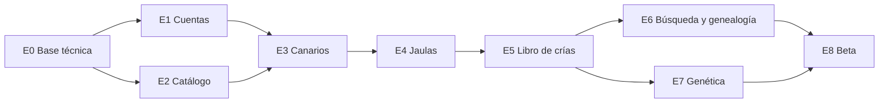

## 3. Por dónde empezar

| Área | No esperan a ninguna otra issue |
|---|---|
| Backend | [#10](https://github.com/JereR1621/sistema-gestion-criadero-canarios/issues/10) T01 · Estructura base del proyecto PHP y entorno de pruebas en AWS |
| Frontend | [#14](https://github.com/JereR1621/sistema-gestion-criadero-canarios/issues/14) T05 · Diseño de pantallas en Figma (mobile-first); y las vistas del hito M1, con datos de ejemplo |
| Pruebas | Las tareas de M5, cuando el sistema esté desplegado en el entorno de pruebas |

En los árboles, cada flecha va de una issue a la que desbloquea. En gris aparecen las issues de otro hito o de otra área de las que depende, y en rosado los ajustes del cliente.

## 4. Árbol de backend

Incluye las tareas de backend, los RF sin pantalla y las partes `[Backend]`.

### M1 Base: cuentas, base de datos y catálogo

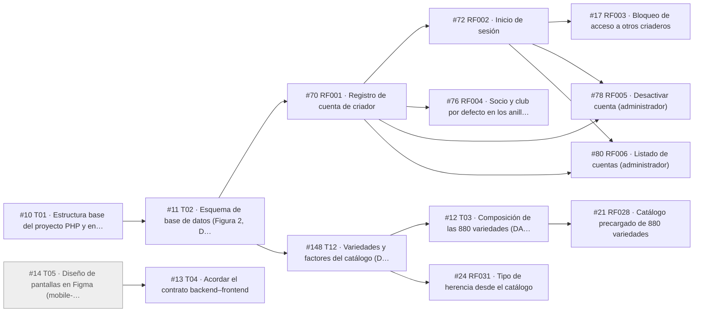

| Etapa | Issue | Espera a | Al cerrarla, desbloquea |
|---|---|---|---|
| 1 | [#10](https://github.com/JereR1621/sistema-gestion-criadero-canarios/issues/10) T01 · Estructura base del proyecto PHP y entorno de pruebas en AWS | — | [#11](https://github.com/JereR1621/sistema-gestion-criadero-canarios/issues/11), [#136](https://github.com/JereR1621/sistema-gestion-criadero-canarios/issues/136), [#145](https://github.com/JereR1621/sistema-gestion-criadero-canarios/issues/145) |
| 2 | [#11](https://github.com/JereR1621/sistema-gestion-criadero-canarios/issues/11) T02 · Esquema de base de datos (Figura 2, DAT-001 y DAT-004) | [#10](https://github.com/JereR1621/sistema-gestion-criadero-canarios/issues/10) | [#70](https://github.com/JereR1621/sistema-gestion-criadero-canarios/issues/70), [#148](https://github.com/JereR1621/sistema-gestion-criadero-canarios/issues/148) |
| 2 | [#13](https://github.com/JereR1621/sistema-gestion-criadero-canarios/issues/13) T04 · Acordar el contrato backend–frontend | [#14](https://github.com/JereR1621/sistema-gestion-criadero-canarios/issues/14) | [#86](https://github.com/JereR1621/sistema-gestion-criadero-canarios/issues/86) |
| 3 | [#70](https://github.com/JereR1621/sistema-gestion-criadero-canarios/issues/70) RF001 · Registro de cuenta de criador | [#11](https://github.com/JereR1621/sistema-gestion-criadero-canarios/issues/11) | [#72](https://github.com/JereR1621/sistema-gestion-criadero-canarios/issues/72), [#76](https://github.com/JereR1621/sistema-gestion-criadero-canarios/issues/76), [#78](https://github.com/JereR1621/sistema-gestion-criadero-canarios/issues/78), [#80](https://github.com/JereR1621/sistema-gestion-criadero-canarios/issues/80) |
| 3 | [#148](https://github.com/JereR1621/sistema-gestion-criadero-canarios/issues/148) T12 · Variedades y factores del catálogo (DAT-005) | [#11](https://github.com/JereR1621/sistema-gestion-criadero-canarios/issues/11) | [#12](https://github.com/JereR1621/sistema-gestion-criadero-canarios/issues/12), [#24](https://github.com/JereR1621/sistema-gestion-criadero-canarios/issues/24), [#82](https://github.com/JereR1621/sistema-gestion-criadero-canarios/issues/82), [#98](https://github.com/JereR1621/sistema-gestion-criadero-canarios/issues/98) |
| 4 | [#12](https://github.com/JereR1621/sistema-gestion-criadero-canarios/issues/12) T03 · Composición de las 880 variedades (DAT-005) | [#148](https://github.com/JereR1621/sistema-gestion-criadero-canarios/issues/148) | [#21](https://github.com/JereR1621/sistema-gestion-criadero-canarios/issues/21) |
| 4 | [#24](https://github.com/JereR1621/sistema-gestion-criadero-canarios/issues/24) RF031 · Tipo de herencia desde el catálogo | [#148](https://github.com/JereR1621/sistema-gestion-criadero-canarios/issues/148) | [#92](https://github.com/JereR1621/sistema-gestion-criadero-canarios/issues/92), [#100](https://github.com/JereR1621/sistema-gestion-criadero-canarios/issues/100), [#86](https://github.com/JereR1621/sistema-gestion-criadero-canarios/issues/86) |
| 4 | [#72](https://github.com/JereR1621/sistema-gestion-criadero-canarios/issues/72) RF002 · Inicio de sesión | [#70](https://github.com/JereR1621/sistema-gestion-criadero-canarios/issues/70) | [#17](https://github.com/JereR1621/sistema-gestion-criadero-canarios/issues/17), [#78](https://github.com/JereR1621/sistema-gestion-criadero-canarios/issues/78), [#80](https://github.com/JereR1621/sistema-gestion-criadero-canarios/issues/80), [#86](https://github.com/JereR1621/sistema-gestion-criadero-canarios/issues/86) |
| 4 | [#76](https://github.com/JereR1621/sistema-gestion-criadero-canarios/issues/76) RF004 · Socio y club por defecto en los anillos | [#70](https://github.com/JereR1621/sistema-gestion-criadero-canarios/issues/70) | [#88](https://github.com/JereR1621/sistema-gestion-criadero-canarios/issues/88), [#116](https://github.com/JereR1621/sistema-gestion-criadero-canarios/issues/116) |
| 5 | [#17](https://github.com/JereR1621/sistema-gestion-criadero-canarios/issues/17) RF003 · Bloqueo de acceso a otros criaderos | [#72](https://github.com/JereR1621/sistema-gestion-criadero-canarios/issues/72) | [#88](https://github.com/JereR1621/sistema-gestion-criadero-canarios/issues/88), [#102](https://github.com/JereR1621/sistema-gestion-criadero-canarios/issues/102) |
| 5 | [#21](https://github.com/JereR1621/sistema-gestion-criadero-canarios/issues/21) RF028 · Catálogo precargado de 880 variedades | [#12](https://github.com/JereR1621/sistema-gestion-criadero-canarios/issues/12) | [#47](https://github.com/JereR1621/sistema-gestion-criadero-canarios/issues/47), [#23](https://github.com/JereR1621/sistema-gestion-criadero-canarios/issues/23), [#86](https://github.com/JereR1621/sistema-gestion-criadero-canarios/issues/86) |
| 5 | [#78](https://github.com/JereR1621/sistema-gestion-criadero-canarios/issues/78) RF005 · Desactivar cuenta (administrador) | [#70](https://github.com/JereR1621/sistema-gestion-criadero-canarios/issues/70), [#72](https://github.com/JereR1621/sistema-gestion-criadero-canarios/issues/72) | — |
| 5 | [#80](https://github.com/JereR1621/sistema-gestion-criadero-canarios/issues/80) RF006 · Listado de cuentas (administrador) | [#70](https://github.com/JereR1621/sistema-gestion-criadero-canarios/issues/70), [#72](https://github.com/JereR1621/sistema-gestion-criadero-canarios/issues/72) | — |

### M2 Núcleo: canarios y jaulas

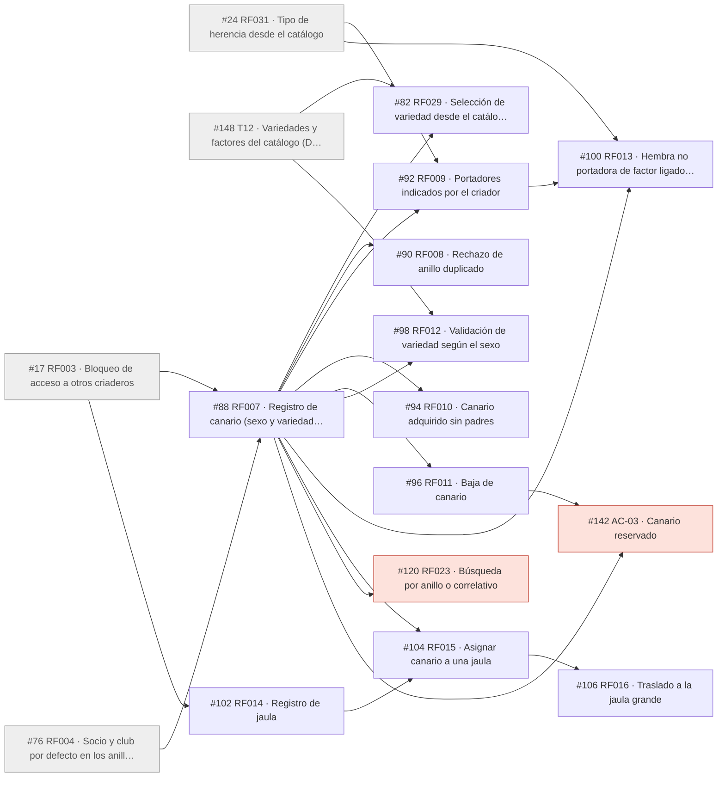

| Etapa | Issue | Espera a | Al cerrarla, desbloquea |
|---|---|---|---|
| 6 | [#88](https://github.com/JereR1621/sistema-gestion-criadero-canarios/issues/88) RF007 · Registro de canario (sexo y variedad pueden quedar sin dete… | [#17](https://github.com/JereR1621/sistema-gestion-criadero-canarios/issues/17), [#76](https://github.com/JereR1621/sistema-gestion-criadero-canarios/issues/76) | [#82](https://github.com/JereR1621/sistema-gestion-criadero-canarios/issues/82), [#90](https://github.com/JereR1621/sistema-gestion-criadero-canarios/issues/90), [#92](https://github.com/JereR1621/sistema-gestion-criadero-canarios/issues/92), [#94](https://github.com/JereR1621/sistema-gestion-criadero-canarios/issues/94), [#96](https://github.com/JereR1621/sistema-gestion-criadero-canarios/issues/96), [#98](https://github.com/JereR1621/sistema-gestion-criadero-canarios/issues/98), [#100](https://github.com/JereR1621/sistema-gestion-criadero-canarios/issues/100), [#104](https://github.com/JereR1621/sistema-gestion-criadero-canarios/issues/104), [#120](https://github.com/JereR1621/sistema-gestion-criadero-canarios/issues/120), [#142](https://github.com/JereR1621/sistema-gestion-criadero-canarios/issues/142), [#110](https://github.com/JereR1621/sistema-gestion-criadero-canarios/issues/110), [#122](https://github.com/JereR1621/sistema-gestion-criadero-canarios/issues/122) |
| 6 | [#102](https://github.com/JereR1621/sistema-gestion-criadero-canarios/issues/102) RF014 · Registro de jaula | [#17](https://github.com/JereR1621/sistema-gestion-criadero-canarios/issues/17) | [#104](https://github.com/JereR1621/sistema-gestion-criadero-canarios/issues/104), [#110](https://github.com/JereR1621/sistema-gestion-criadero-canarios/issues/110) |
| 7 | [#82](https://github.com/JereR1621/sistema-gestion-criadero-canarios/issues/82) RF029 · Selección de variedad desde el catálogo | [#88](https://github.com/JereR1621/sistema-gestion-criadero-canarios/issues/88), [#148](https://github.com/JereR1621/sistema-gestion-criadero-canarios/issues/148) | [#124](https://github.com/JereR1621/sistema-gestion-criadero-canarios/issues/124) |
| 7 | [#90](https://github.com/JereR1621/sistema-gestion-criadero-canarios/issues/90) RF008 · Rechazo de anillo duplicado | [#88](https://github.com/JereR1621/sistema-gestion-criadero-canarios/issues/88) | [#116](https://github.com/JereR1621/sistema-gestion-criadero-canarios/issues/116) |
| 7 | [#92](https://github.com/JereR1621/sistema-gestion-criadero-canarios/issues/92) RF009 · Portadores indicados por el criador | [#88](https://github.com/JereR1621/sistema-gestion-criadero-canarios/issues/88), [#24](https://github.com/JereR1621/sistema-gestion-criadero-canarios/issues/24) | [#100](https://github.com/JereR1621/sistema-gestion-criadero-canarios/issues/100), [#48](https://github.com/JereR1621/sistema-gestion-criadero-canarios/issues/48) |
| 7 | [#94](https://github.com/JereR1621/sistema-gestion-criadero-canarios/issues/94) RF010 · Canario adquirido sin padres | [#88](https://github.com/JereR1621/sistema-gestion-criadero-canarios/issues/88) | — |
| 7 | [#96](https://github.com/JereR1621/sistema-gestion-criadero-canarios/issues/96) RF011 · Baja de canario | [#88](https://github.com/JereR1621/sistema-gestion-criadero-canarios/issues/88) | [#142](https://github.com/JereR1621/sistema-gestion-criadero-canarios/issues/142) |
| 7 | [#98](https://github.com/JereR1621/sistema-gestion-criadero-canarios/issues/98) RF012 · Validación de variedad según el sexo | [#88](https://github.com/JereR1621/sistema-gestion-criadero-canarios/issues/88), [#148](https://github.com/JereR1621/sistema-gestion-criadero-canarios/issues/148) | — |
| 7 | [#104](https://github.com/JereR1621/sistema-gestion-criadero-canarios/issues/104) RF015 · Asignar canario a una jaula | [#102](https://github.com/JereR1621/sistema-gestion-criadero-canarios/issues/102), [#88](https://github.com/JereR1621/sistema-gestion-criadero-canarios/issues/88) | [#106](https://github.com/JereR1621/sistema-gestion-criadero-canarios/issues/106), [#108](https://github.com/JereR1621/sistema-gestion-criadero-canarios/issues/108), [#124](https://github.com/JereR1621/sistema-gestion-criadero-canarios/issues/124), [#126](https://github.com/JereR1621/sistema-gestion-criadero-canarios/issues/126) |
| 7 | [#120](https://github.com/JereR1621/sistema-gestion-criadero-canarios/issues/120) RF023 · Búsqueda por anillo o correlativo | [#88](https://github.com/JereR1621/sistema-gestion-criadero-canarios/issues/88) | [#122](https://github.com/JereR1621/sistema-gestion-criadero-canarios/issues/122), [#124](https://github.com/JereR1621/sistema-gestion-criadero-canarios/issues/124), [#126](https://github.com/JereR1621/sistema-gestion-criadero-canarios/issues/126) |
| 8 | [#100](https://github.com/JereR1621/sistema-gestion-criadero-canarios/issues/100) RF013 · Hembra no portadora de factor ligado al sexo | [#92](https://github.com/JereR1621/sistema-gestion-criadero-canarios/issues/92), [#24](https://github.com/JereR1621/sistema-gestion-criadero-canarios/issues/24), [#88](https://github.com/JereR1621/sistema-gestion-criadero-canarios/issues/88) | — |
| 8 | [#106](https://github.com/JereR1621/sistema-gestion-criadero-canarios/issues/106) RF016 · Traslado a la jaula grande | [#104](https://github.com/JereR1621/sistema-gestion-criadero-canarios/issues/104) | — |
| 8 | [#142](https://github.com/JereR1621/sistema-gestion-criadero-canarios/issues/142) AC-03 · Canario reservado | [#88](https://github.com/JereR1621/sistema-gestion-criadero-canarios/issues/88), [#96](https://github.com/JereR1621/sistema-gestion-criadero-canarios/issues/96) | [#110](https://github.com/JereR1621/sistema-gestion-criadero-canarios/issues/110) |

### M3 Crías, búsqueda y genealogía

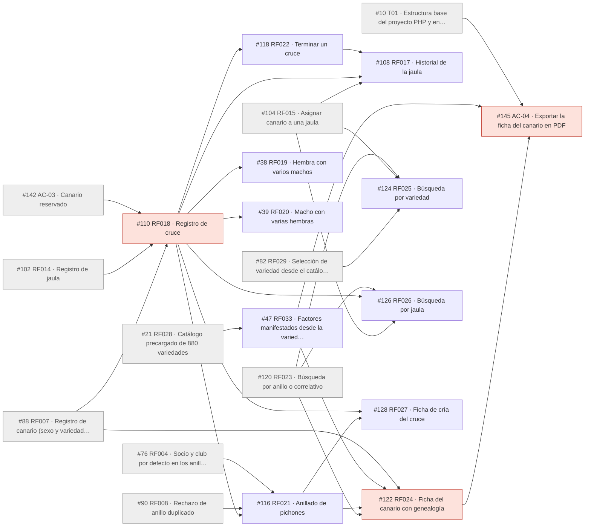

| Etapa | Issue | Espera a | Al cerrarla, desbloquea |
|---|---|---|---|
| 6 | [#47](https://github.com/JereR1621/sistema-gestion-criadero-canarios/issues/47) RF033 · Factores manifestados desde la variedad | [#21](https://github.com/JereR1621/sistema-gestion-criadero-canarios/issues/21) | [#122](https://github.com/JereR1621/sistema-gestion-criadero-canarios/issues/122), [#145](https://github.com/JereR1621/sistema-gestion-criadero-canarios/issues/145), [#48](https://github.com/JereR1621/sistema-gestion-criadero-canarios/issues/48), [#50](https://github.com/JereR1621/sistema-gestion-criadero-canarios/issues/50), [#51](https://github.com/JereR1621/sistema-gestion-criadero-canarios/issues/51), [#52](https://github.com/JereR1621/sistema-gestion-criadero-canarios/issues/52), [#132](https://github.com/JereR1621/sistema-gestion-criadero-canarios/issues/132) |
| 8 | [#124](https://github.com/JereR1621/sistema-gestion-criadero-canarios/issues/124) RF025 · Búsqueda por variedad | [#82](https://github.com/JereR1621/sistema-gestion-criadero-canarios/issues/82), [#104](https://github.com/JereR1621/sistema-gestion-criadero-canarios/issues/104), [#120](https://github.com/JereR1621/sistema-gestion-criadero-canarios/issues/120) | — |
| 9 | [#110](https://github.com/JereR1621/sistema-gestion-criadero-canarios/issues/110) RF018 · Registro de cruce | [#88](https://github.com/JereR1621/sistema-gestion-criadero-canarios/issues/88), [#102](https://github.com/JereR1621/sistema-gestion-criadero-canarios/issues/102), [#142](https://github.com/JereR1621/sistema-gestion-criadero-canarios/issues/142) | [#38](https://github.com/JereR1621/sistema-gestion-criadero-canarios/issues/38), [#39](https://github.com/JereR1621/sistema-gestion-criadero-canarios/issues/39), [#108](https://github.com/JereR1621/sistema-gestion-criadero-canarios/issues/108), [#116](https://github.com/JereR1621/sistema-gestion-criadero-canarios/issues/116), [#118](https://github.com/JereR1621/sistema-gestion-criadero-canarios/issues/118), [#126](https://github.com/JereR1621/sistema-gestion-criadero-canarios/issues/126), [#128](https://github.com/JereR1621/sistema-gestion-criadero-canarios/issues/128) |
| 10 | [#38](https://github.com/JereR1621/sistema-gestion-criadero-canarios/issues/38) RF019 · Hembra con varios machos | [#110](https://github.com/JereR1621/sistema-gestion-criadero-canarios/issues/110) | — |
| 10 | [#39](https://github.com/JereR1621/sistema-gestion-criadero-canarios/issues/39) RF020 · Macho con varias hembras | [#110](https://github.com/JereR1621/sistema-gestion-criadero-canarios/issues/110) | — |
| 10 | [#116](https://github.com/JereR1621/sistema-gestion-criadero-canarios/issues/116) RF021 · Anillado de pichones | [#110](https://github.com/JereR1621/sistema-gestion-criadero-canarios/issues/110), [#90](https://github.com/JereR1621/sistema-gestion-criadero-canarios/issues/90), [#76](https://github.com/JereR1621/sistema-gestion-criadero-canarios/issues/76) | [#122](https://github.com/JereR1621/sistema-gestion-criadero-canarios/issues/122), [#128](https://github.com/JereR1621/sistema-gestion-criadero-canarios/issues/128), [#48](https://github.com/JereR1621/sistema-gestion-criadero-canarios/issues/48) |
| 10 | [#118](https://github.com/JereR1621/sistema-gestion-criadero-canarios/issues/118) RF022 · Terminar un cruce | [#110](https://github.com/JereR1621/sistema-gestion-criadero-canarios/issues/110) | [#108](https://github.com/JereR1621/sistema-gestion-criadero-canarios/issues/108) |
| 10 | [#126](https://github.com/JereR1621/sistema-gestion-criadero-canarios/issues/126) RF026 · Búsqueda por jaula | [#104](https://github.com/JereR1621/sistema-gestion-criadero-canarios/issues/104), [#110](https://github.com/JereR1621/sistema-gestion-criadero-canarios/issues/110), [#120](https://github.com/JereR1621/sistema-gestion-criadero-canarios/issues/120) | — |
| 11 | [#108](https://github.com/JereR1621/sistema-gestion-criadero-canarios/issues/108) RF017 · Historial de la jaula | [#104](https://github.com/JereR1621/sistema-gestion-criadero-canarios/issues/104), [#110](https://github.com/JereR1621/sistema-gestion-criadero-canarios/issues/110), [#118](https://github.com/JereR1621/sistema-gestion-criadero-canarios/issues/118) | — |
| 11 | [#122](https://github.com/JereR1621/sistema-gestion-criadero-canarios/issues/122) RF024 · Ficha del canario con genealogía | [#120](https://github.com/JereR1621/sistema-gestion-criadero-canarios/issues/120), [#116](https://github.com/JereR1621/sistema-gestion-criadero-canarios/issues/116), [#47](https://github.com/JereR1621/sistema-gestion-criadero-canarios/issues/47), [#88](https://github.com/JereR1621/sistema-gestion-criadero-canarios/issues/88) | [#145](https://github.com/JereR1621/sistema-gestion-criadero-canarios/issues/145) |
| 11 | [#128](https://github.com/JereR1621/sistema-gestion-criadero-canarios/issues/128) RF027 · Ficha de cría del cruce | [#116](https://github.com/JereR1621/sistema-gestion-criadero-canarios/issues/116), [#110](https://github.com/JereR1621/sistema-gestion-criadero-canarios/issues/110) | — |
| 12 | [#145](https://github.com/JereR1621/sistema-gestion-criadero-canarios/issues/145) AC-04 · Exportar la ficha del canario en PDF | [#122](https://github.com/JereR1621/sistema-gestion-criadero-canarios/issues/122), [#47](https://github.com/JereR1621/sistema-gestion-criadero-canarios/issues/47), [#10](https://github.com/JereR1621/sistema-gestion-criadero-canarios/issues/10) | — |

### M4 Genética y previsualización de cruces

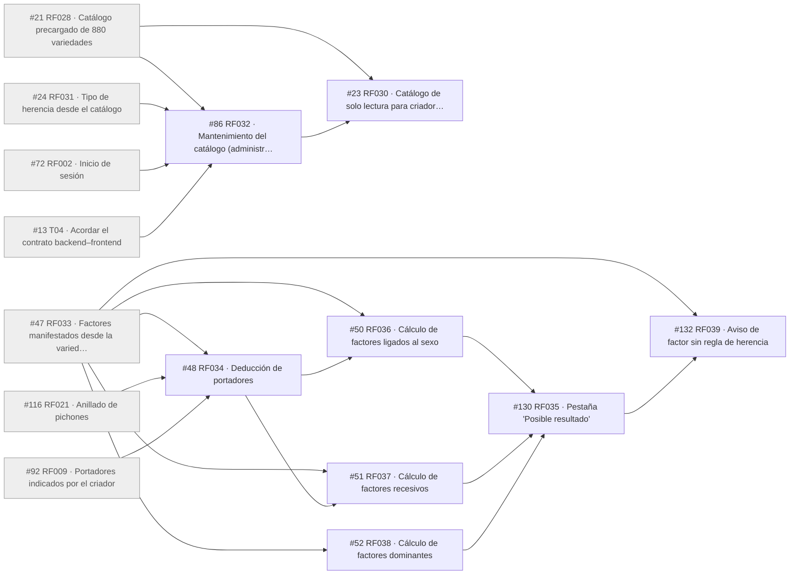

| Etapa | Issue | Espera a | Al cerrarla, desbloquea |
|---|---|---|---|
| 6 | [#86](https://github.com/JereR1621/sistema-gestion-criadero-canarios/issues/86) RF032 · Mantenimiento del catálogo (administrador) | [#21](https://github.com/JereR1621/sistema-gestion-criadero-canarios/issues/21), [#24](https://github.com/JereR1621/sistema-gestion-criadero-canarios/issues/24), [#72](https://github.com/JereR1621/sistema-gestion-criadero-canarios/issues/72), [#13](https://github.com/JereR1621/sistema-gestion-criadero-canarios/issues/13) | [#23](https://github.com/JereR1621/sistema-gestion-criadero-canarios/issues/23) |
| 7 | [#23](https://github.com/JereR1621/sistema-gestion-criadero-canarios/issues/23) RF030 · Catálogo de solo lectura para criadores | [#21](https://github.com/JereR1621/sistema-gestion-criadero-canarios/issues/21), [#86](https://github.com/JereR1621/sistema-gestion-criadero-canarios/issues/86) | — |
| 7 | [#52](https://github.com/JereR1621/sistema-gestion-criadero-canarios/issues/52) RF038 · Cálculo de factores dominantes | [#47](https://github.com/JereR1621/sistema-gestion-criadero-canarios/issues/47) | [#130](https://github.com/JereR1621/sistema-gestion-criadero-canarios/issues/130) |
| 11 | [#48](https://github.com/JereR1621/sistema-gestion-criadero-canarios/issues/48) RF034 · Deducción de portadores | [#47](https://github.com/JereR1621/sistema-gestion-criadero-canarios/issues/47), [#116](https://github.com/JereR1621/sistema-gestion-criadero-canarios/issues/116), [#92](https://github.com/JereR1621/sistema-gestion-criadero-canarios/issues/92) | [#50](https://github.com/JereR1621/sistema-gestion-criadero-canarios/issues/50), [#51](https://github.com/JereR1621/sistema-gestion-criadero-canarios/issues/51) |
| 12 | [#50](https://github.com/JereR1621/sistema-gestion-criadero-canarios/issues/50) RF036 · Cálculo de factores ligados al sexo | [#47](https://github.com/JereR1621/sistema-gestion-criadero-canarios/issues/47), [#48](https://github.com/JereR1621/sistema-gestion-criadero-canarios/issues/48) | [#130](https://github.com/JereR1621/sistema-gestion-criadero-canarios/issues/130) |
| 12 | [#51](https://github.com/JereR1621/sistema-gestion-criadero-canarios/issues/51) RF037 · Cálculo de factores recesivos | [#47](https://github.com/JereR1621/sistema-gestion-criadero-canarios/issues/47), [#48](https://github.com/JereR1621/sistema-gestion-criadero-canarios/issues/48) | [#130](https://github.com/JereR1621/sistema-gestion-criadero-canarios/issues/130) |
| 13 | [#130](https://github.com/JereR1621/sistema-gestion-criadero-canarios/issues/130) RF035 · Pestaña "Posible resultado" | [#50](https://github.com/JereR1621/sistema-gestion-criadero-canarios/issues/50), [#51](https://github.com/JereR1621/sistema-gestion-criadero-canarios/issues/51), [#52](https://github.com/JereR1621/sistema-gestion-criadero-canarios/issues/52) | [#132](https://github.com/JereR1621/sistema-gestion-criadero-canarios/issues/132) |
| 14 | [#132](https://github.com/JereR1621/sistema-gestion-criadero-canarios/issues/132) RF039 · Aviso de factor sin regla de herencia | [#47](https://github.com/JereR1621/sistema-gestion-criadero-canarios/issues/47), [#130](https://github.com/JereR1621/sistema-gestion-criadero-canarios/issues/130) | — |

### M5 Beta: pruebas, seguridad y despliegue

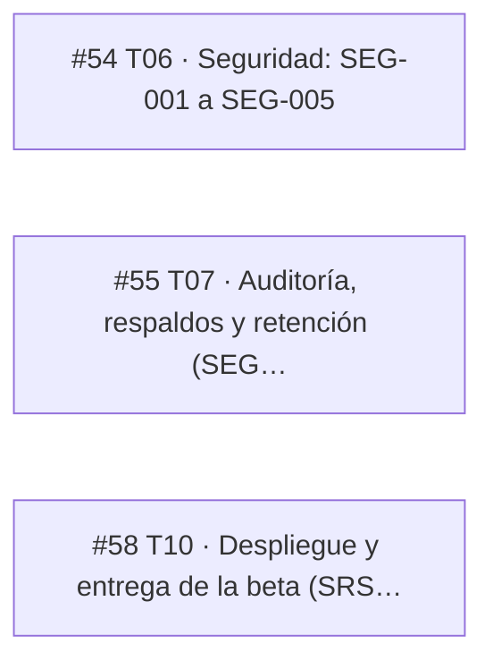

| Etapa | Issue | Espera a | Al cerrarla, desbloquea |
|---|---|---|---|
| Final | [#54](https://github.com/JereR1621/sistema-gestion-criadero-canarios/issues/54) T06 · Seguridad: SEG-001 a SEG-005 | [#7](https://github.com/JereR1621/sistema-gestion-criadero-canarios/issues/7), [#8](https://github.com/JereR1621/sistema-gestion-criadero-canarios/issues/8) | [#63](https://github.com/JereR1621/sistema-gestion-criadero-canarios/issues/63) |
| Final | [#55](https://github.com/JereR1621/sistema-gestion-criadero-canarios/issues/55) T07 · Auditoría, respaldos y retención (SEG-003, DAT-002, DAT-003… | [#7](https://github.com/JereR1621/sistema-gestion-criadero-canarios/issues/7), [#8](https://github.com/JereR1621/sistema-gestion-criadero-canarios/issues/8) | [#63](https://github.com/JereR1621/sistema-gestion-criadero-canarios/issues/63) |
| Final | [#58](https://github.com/JereR1621/sistema-gestion-criadero-canarios/issues/58) T10 · Despliegue y entrega de la beta (SRS §10) | [#59](https://github.com/JereR1621/sistema-gestion-criadero-canarios/issues/59), [#60](https://github.com/JereR1621/sistema-gestion-criadero-canarios/issues/60), [#61](https://github.com/JereR1621/sistema-gestion-criadero-canarios/issues/61), [#62](https://github.com/JereR1621/sistema-gestion-criadero-canarios/issues/62), [#63](https://github.com/JereR1621/sistema-gestion-criadero-canarios/issues/63) | — |

## 5. Árbol de frontend

Incluye las tareas de frontend y las partes `[Frontend]`. Una flecha significa que la issue de origen crea la vista que la otra edita.

### M1 Base: cuentas, base de datos y catálogo

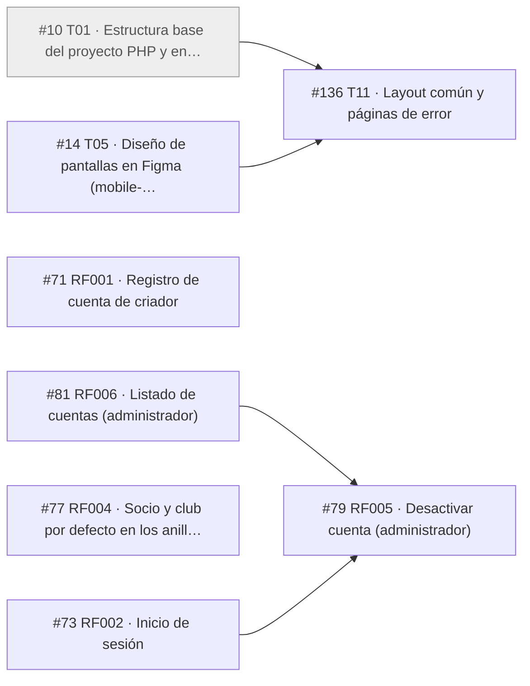

| Etapa | Issue | Espera a | Al cerrarla, desbloquea |
|---|---|---|---|
| 1 | [#14](https://github.com/JereR1621/sistema-gestion-criadero-canarios/issues/14) T05 · Diseño de pantallas en Figma (mobile-first) | — | [#13](https://github.com/JereR1621/sistema-gestion-criadero-canarios/issues/13), [#136](https://github.com/JereR1621/sistema-gestion-criadero-canarios/issues/136) |
| 1 | [#71](https://github.com/JereR1621/sistema-gestion-criadero-canarios/issues/71) RF001 · Registro de cuenta de criador | — | — |
| 1 | [#73](https://github.com/JereR1621/sistema-gestion-criadero-canarios/issues/73) RF002 · Inicio de sesión | — | [#79](https://github.com/JereR1621/sistema-gestion-criadero-canarios/issues/79) |
| 1 | [#77](https://github.com/JereR1621/sistema-gestion-criadero-canarios/issues/77) RF004 · Socio y club por defecto en los anillos | — | — |
| 1 | [#81](https://github.com/JereR1621/sistema-gestion-criadero-canarios/issues/81) RF006 · Listado de cuentas (administrador) | — | [#79](https://github.com/JereR1621/sistema-gestion-criadero-canarios/issues/79) |
| 2 | [#79](https://github.com/JereR1621/sistema-gestion-criadero-canarios/issues/79) RF005 · Desactivar cuenta (administrador) | [#81](https://github.com/JereR1621/sistema-gestion-criadero-canarios/issues/81), [#73](https://github.com/JereR1621/sistema-gestion-criadero-canarios/issues/73) | — |
| 2 | [#136](https://github.com/JereR1621/sistema-gestion-criadero-canarios/issues/136) T11 · Layout común y páginas de error | [#10](https://github.com/JereR1621/sistema-gestion-criadero-canarios/issues/10), [#14](https://github.com/JereR1621/sistema-gestion-criadero-canarios/issues/14) | — |

### M2 Núcleo: canarios y jaulas

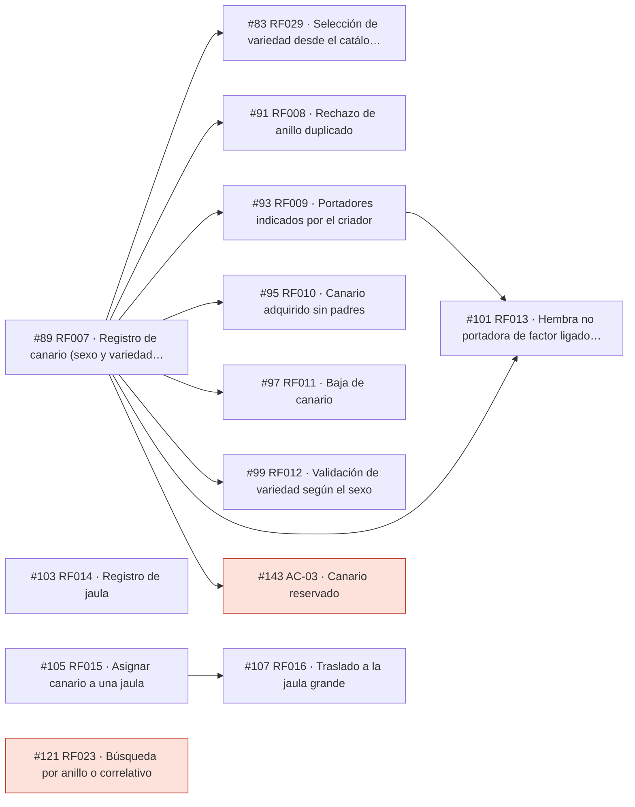

| Etapa | Issue | Espera a | Al cerrarla, desbloquea |
|---|---|---|---|
| 1 | [#89](https://github.com/JereR1621/sistema-gestion-criadero-canarios/issues/89) RF007 · Registro de canario (sexo y variedad pueden quedar sin dete… | — | [#83](https://github.com/JereR1621/sistema-gestion-criadero-canarios/issues/83), [#91](https://github.com/JereR1621/sistema-gestion-criadero-canarios/issues/91), [#93](https://github.com/JereR1621/sistema-gestion-criadero-canarios/issues/93), [#95](https://github.com/JereR1621/sistema-gestion-criadero-canarios/issues/95), [#97](https://github.com/JereR1621/sistema-gestion-criadero-canarios/issues/97), [#99](https://github.com/JereR1621/sistema-gestion-criadero-canarios/issues/99), [#101](https://github.com/JereR1621/sistema-gestion-criadero-canarios/issues/101), [#143](https://github.com/JereR1621/sistema-gestion-criadero-canarios/issues/143), [#123](https://github.com/JereR1621/sistema-gestion-criadero-canarios/issues/123) |
| 1 | [#103](https://github.com/JereR1621/sistema-gestion-criadero-canarios/issues/103) RF014 · Registro de jaula | — | — |
| 1 | [#105](https://github.com/JereR1621/sistema-gestion-criadero-canarios/issues/105) RF015 · Asignar canario a una jaula | — | [#107](https://github.com/JereR1621/sistema-gestion-criadero-canarios/issues/107) |
| 1 | [#121](https://github.com/JereR1621/sistema-gestion-criadero-canarios/issues/121) RF023 · Búsqueda por anillo o correlativo | — | [#125](https://github.com/JereR1621/sistema-gestion-criadero-canarios/issues/125), [#127](https://github.com/JereR1621/sistema-gestion-criadero-canarios/issues/127) |
| 2 | [#83](https://github.com/JereR1621/sistema-gestion-criadero-canarios/issues/83) RF029 · Selección de variedad desde el catálogo | [#89](https://github.com/JereR1621/sistema-gestion-criadero-canarios/issues/89) | — |
| 2 | [#91](https://github.com/JereR1621/sistema-gestion-criadero-canarios/issues/91) RF008 · Rechazo de anillo duplicado | [#89](https://github.com/JereR1621/sistema-gestion-criadero-canarios/issues/89) | — |
| 2 | [#93](https://github.com/JereR1621/sistema-gestion-criadero-canarios/issues/93) RF009 · Portadores indicados por el criador | [#89](https://github.com/JereR1621/sistema-gestion-criadero-canarios/issues/89) | [#101](https://github.com/JereR1621/sistema-gestion-criadero-canarios/issues/101) |
| 2 | [#95](https://github.com/JereR1621/sistema-gestion-criadero-canarios/issues/95) RF010 · Canario adquirido sin padres | [#89](https://github.com/JereR1621/sistema-gestion-criadero-canarios/issues/89) | — |
| 2 | [#97](https://github.com/JereR1621/sistema-gestion-criadero-canarios/issues/97) RF011 · Baja de canario | [#89](https://github.com/JereR1621/sistema-gestion-criadero-canarios/issues/89) | — |
| 2 | [#99](https://github.com/JereR1621/sistema-gestion-criadero-canarios/issues/99) RF012 · Validación de variedad según el sexo | [#89](https://github.com/JereR1621/sistema-gestion-criadero-canarios/issues/89) | — |
| 2 | [#107](https://github.com/JereR1621/sistema-gestion-criadero-canarios/issues/107) RF016 · Traslado a la jaula grande | [#105](https://github.com/JereR1621/sistema-gestion-criadero-canarios/issues/105) | — |
| 2 | [#143](https://github.com/JereR1621/sistema-gestion-criadero-canarios/issues/143) AC-03 · Canario reservado | [#89](https://github.com/JereR1621/sistema-gestion-criadero-canarios/issues/89) | — |
| 3 | [#101](https://github.com/JereR1621/sistema-gestion-criadero-canarios/issues/101) RF013 · Hembra no portadora de factor ligado al sexo | [#89](https://github.com/JereR1621/sistema-gestion-criadero-canarios/issues/89), [#93](https://github.com/JereR1621/sistema-gestion-criadero-canarios/issues/93) | — |

### M3 Crías, búsqueda y genealogía

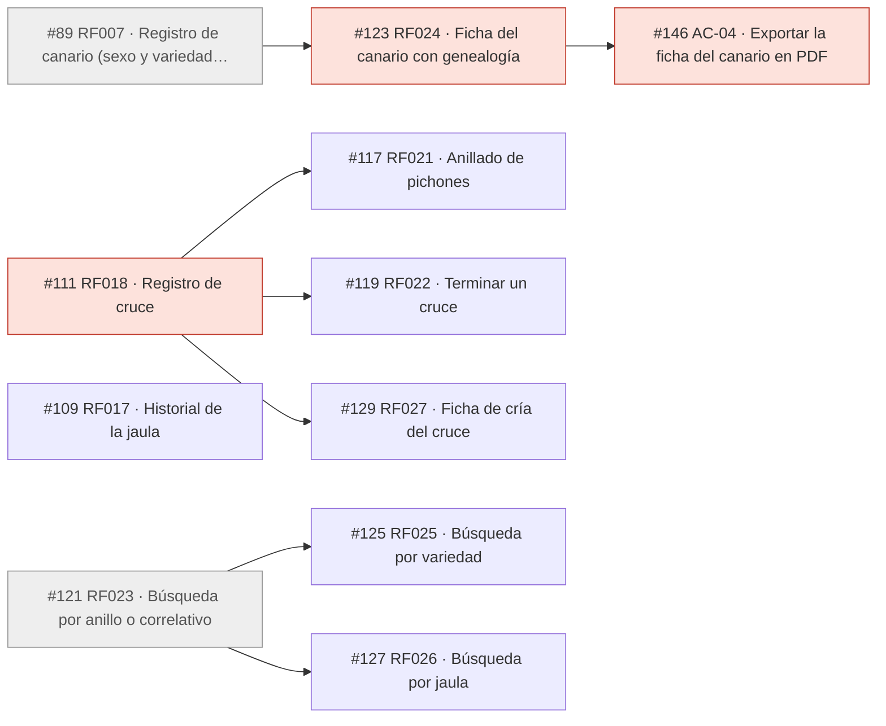

| Etapa | Issue | Espera a | Al cerrarla, desbloquea |
|---|---|---|---|
| 1 | [#109](https://github.com/JereR1621/sistema-gestion-criadero-canarios/issues/109) RF017 · Historial de la jaula | — | — |
| 1 | [#111](https://github.com/JereR1621/sistema-gestion-criadero-canarios/issues/111) RF018 · Registro de cruce | — | [#117](https://github.com/JereR1621/sistema-gestion-criadero-canarios/issues/117), [#119](https://github.com/JereR1621/sistema-gestion-criadero-canarios/issues/119), [#129](https://github.com/JereR1621/sistema-gestion-criadero-canarios/issues/129), [#131](https://github.com/JereR1621/sistema-gestion-criadero-canarios/issues/131) |
| 2 | [#117](https://github.com/JereR1621/sistema-gestion-criadero-canarios/issues/117) RF021 · Anillado de pichones | [#111](https://github.com/JereR1621/sistema-gestion-criadero-canarios/issues/111) | — |
| 2 | [#119](https://github.com/JereR1621/sistema-gestion-criadero-canarios/issues/119) RF022 · Terminar un cruce | [#111](https://github.com/JereR1621/sistema-gestion-criadero-canarios/issues/111) | — |
| 2 | [#123](https://github.com/JereR1621/sistema-gestion-criadero-canarios/issues/123) RF024 · Ficha del canario con genealogía | [#89](https://github.com/JereR1621/sistema-gestion-criadero-canarios/issues/89) | [#146](https://github.com/JereR1621/sistema-gestion-criadero-canarios/issues/146) |
| 2 | [#125](https://github.com/JereR1621/sistema-gestion-criadero-canarios/issues/125) RF025 · Búsqueda por variedad | [#121](https://github.com/JereR1621/sistema-gestion-criadero-canarios/issues/121) | — |
| 2 | [#127](https://github.com/JereR1621/sistema-gestion-criadero-canarios/issues/127) RF026 · Búsqueda por jaula | [#121](https://github.com/JereR1621/sistema-gestion-criadero-canarios/issues/121) | — |
| 2 | [#129](https://github.com/JereR1621/sistema-gestion-criadero-canarios/issues/129) RF027 · Ficha de cría del cruce | [#111](https://github.com/JereR1621/sistema-gestion-criadero-canarios/issues/111) | — |
| 3 | [#146](https://github.com/JereR1621/sistema-gestion-criadero-canarios/issues/146) AC-04 · Exportar la ficha del canario en PDF | [#123](https://github.com/JereR1621/sistema-gestion-criadero-canarios/issues/123) | — |

### M4 Genética y previsualización de cruces

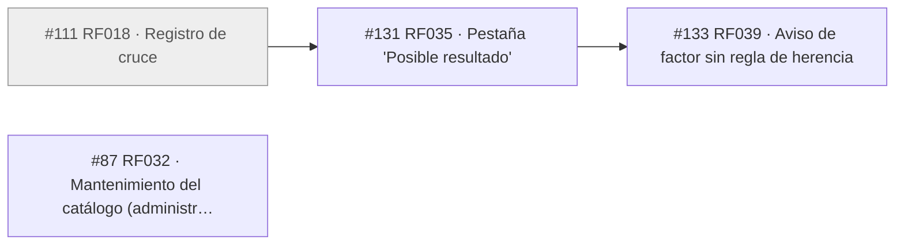

| Etapa | Issue | Espera a | Al cerrarla, desbloquea |
|---|---|---|---|
| 1 | [#87](https://github.com/JereR1621/sistema-gestion-criadero-canarios/issues/87) RF032 · Mantenimiento del catálogo (administrador) | — | — |
| 2 | [#131](https://github.com/JereR1621/sistema-gestion-criadero-canarios/issues/131) RF035 · Pestaña "Posible resultado" | [#111](https://github.com/JereR1621/sistema-gestion-criadero-canarios/issues/111) | [#133](https://github.com/JereR1621/sistema-gestion-criadero-canarios/issues/133) |
| 3 | [#133](https://github.com/JereR1621/sistema-gestion-criadero-canarios/issues/133) RF039 · Aviso de factor sin regla de herencia | [#131](https://github.com/JereR1621/sistema-gestion-criadero-canarios/issues/131) | — |

## 6. Pruebas internas

Tareas del equipo en el entorno de pruebas, antes de la revisión externa de M5.

### M5 Beta: pruebas, seguridad y despliegue

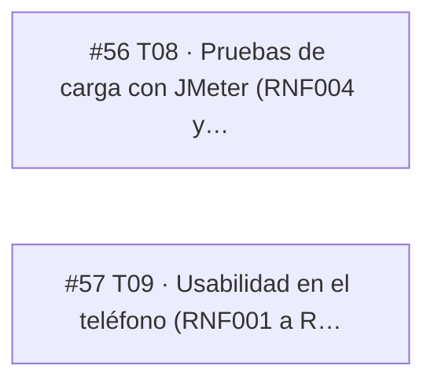

| Etapa | Issue | Espera a | Al cerrarla, desbloquea |
|---|---|---|---|
| Final | [#56](https://github.com/JereR1621/sistema-gestion-criadero-canarios/issues/56) T08 · Pruebas de carga con JMeter (RNF004 y RNF005) | [#7](https://github.com/JereR1621/sistema-gestion-criadero-canarios/issues/7), [#8](https://github.com/JereR1621/sistema-gestion-criadero-canarios/issues/8) | [#63](https://github.com/JereR1621/sistema-gestion-criadero-canarios/issues/63) |
| Final | [#57](https://github.com/JereR1621/sistema-gestion-criadero-canarios/issues/57) T09 · Usabilidad en el teléfono (RNF001 a RNF003) | [#7](https://github.com/JereR1621/sistema-gestion-criadero-canarios/issues/7), [#8](https://github.com/JereR1621/sistema-gestion-criadero-canarios/issues/8) | [#63](https://github.com/JereR1621/sistema-gestion-criadero-canarios/issues/63) |

## 7. Ajustes del cliente

- [#37](https://github.com/JereR1621/sistema-gestion-criadero-canarios/issues/37) RF018 · Registro de cruce
- [#42](https://github.com/JereR1621/sistema-gestion-criadero-canarios/issues/42) RF023 · Búsqueda por anillo o correlativo
- [#43](https://github.com/JereR1621/sistema-gestion-criadero-canarios/issues/43) RF024 · Ficha del canario con genealogía
- [#110](https://github.com/JereR1621/sistema-gestion-criadero-canarios/issues/110) RF018 · Registro de cruce
- [#111](https://github.com/JereR1621/sistema-gestion-criadero-canarios/issues/111) RF018 · Registro de cruce
- [#120](https://github.com/JereR1621/sistema-gestion-criadero-canarios/issues/120) RF023 · Búsqueda por anillo o correlativo
- [#121](https://github.com/JereR1621/sistema-gestion-criadero-canarios/issues/121) RF023 · Búsqueda por anillo o correlativo
- [#122](https://github.com/JereR1621/sistema-gestion-criadero-canarios/issues/122) RF024 · Ficha del canario con genealogía
- [#123](https://github.com/JereR1621/sistema-gestion-criadero-canarios/issues/123) RF024 · Ficha del canario con genealogía
- [#141](https://github.com/JereR1621/sistema-gestion-criadero-canarios/issues/141) AC-03 · Canario reservado
- [#142](https://github.com/JereR1621/sistema-gestion-criadero-canarios/issues/142) AC-03 · Canario reservado
- [#143](https://github.com/JereR1621/sistema-gestion-criadero-canarios/issues/143) AC-03 · Canario reservado
- [#144](https://github.com/JereR1621/sistema-gestion-criadero-canarios/issues/144) AC-04 · Exportar la ficha del canario en PDF
- [#145](https://github.com/JereR1621/sistema-gestion-criadero-canarios/issues/145) AC-04 · Exportar la ficha del canario en PDF
- [#146](https://github.com/JereR1621/sistema-gestion-criadero-canarios/issues/146) AC-04 · Exportar la ficha del canario en PDF
